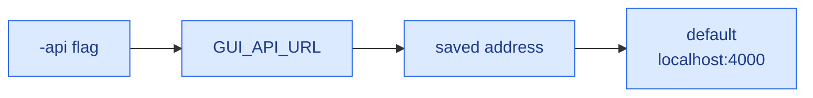

<sub>🏠 [Home](https://github.com/fiwon123/eznit/wiki) › 📖 Reference › ⚙️ Configuration</sub>

# ⚙️ Configuration

**Every variable, secret, port and file, in one place.** eznit reads environment
variables and two local files. The API loads `.env.local` and then `.env` (the
first one wins), and Compose sets the in-network values itself.

| Section | For |
| --- | --- |
| 🔌 [API environment](#-api-environment) | the server: database, uploads, logs, port |
| 🖥️ [Desktop window](#%EF%B8%8F-desktop-window) | which server the window talks to |
| 🚦 [Auth rate limiting](#-auth-rate-limiting) | throttling signup and login |
| 🌐 [Ports and bind addresses](#-ports-and-bind-addresses) | what listens where, and who can reach it |
| 🔐 [Files and secrets](#-files-and-secrets) | what is committed, what must be mode `600` |
| 💻 [CLI](https://github.com/fiwon123/eznit/wiki/CLI-Reference#-cli-environment-variables) | the client's variables (on the CLI page) |

## 🔌 API environment

| Variable | Default | Meaning |
| --- | --- | --- |
| `DB_HOST` · `DB_PORT` · `DB_USER` · `DB_NAME` | | the PostgreSQL connection |
| `DB_PASSWORD_FILE` | | path to a file holding the password (**preferred**) |
| `DB_PWD` | | the password inline, for a throwaway local database |
| `API_UPLOADS` | *(unset)* | where file bytes live. Set it; the example uses `./uploads`. |
| `API_LOGS` | `./logs` | rotating API logs |
| `API_WEB_DIST` | `web/dist` | a built UI, when one exists |
| `API_SERVE_WEB` | `true` | serve the UI from this process (the Compose `api` and `dev` services set `false`) |
| `API_PORT` | `4000` | the bind port |

> [!TIP]
> Prefer `DB_PASSWORD_FILE` over `DB_PWD`. The variable puts the password in the
> process environment, and the file does not. In the Compose stack,
> `secrets/db_password.txt` is mounted at `/run/secrets/db_password` and
> `DB_PASSWORD_FILE` points there.

> [!NOTE]
> `API_PORT` only moves the bind port (and the published host port in Compose). It
> does not change what the CLI expects (`:4000`), and it does not put the service
> behind a proxy by itself.

## 🖥️ Desktop window

The window is a client: it talks to an eznit API and runs no HTTP server of its
own (so there is no `GUI_PORT`).

| Variable | Default | Meaning |
| --- | --- | --- |
| `GUI_API_URL` | `http://localhost:4000` | the server to talk to. It wins over the address saved in the app, so a wrapper script keeps working. |
| `EZNIT_CONFIG` | `~/.eznit/config.json` | the file shared with the CLI: the server address (`api_url`) and the session |

The address is chosen in **Settings → Server**: **Use this machine** (the port
Local server's configuration names) or any other address, with **Test** before
**Connect**. The page names where the current address came from, in this order:



> [!IMPORTANT]
> A session belongs to the server that issued it. **Changing the host signs you
> out**, while changing only the port on the same host does not.

## 🚦 Auth rate limiting

`signup` and `login` are throttled per IP and per submitted address. A request
over the limit gets `429` with a `Retry-After` header. Each process enforces its own limits,
so this guards one instance; it is not a distributed limiter.

| Variable | Default | Meaning |
| --- | ---: | --- |
| `RATE_LIMIT_ENABLED` | `true` | the throttle on or off |
| `RATE_LIMIT_WINDOW` | `15m` | the window every limit counts over |
| `RATE_LIMIT_LOGIN_IP` | `20` | login attempts per IP |
| `RATE_LIMIT_LOGIN_EMAIL` | `10` | login attempts per address |
| `RATE_LIMIT_SIGNUP_IP` | `10` | signups per IP |
| `RATE_LIMIT_SIGNUP_EMAIL` | `5` | signups per address |
| `TRUST_PROXY` | `false` | trust `X-Real-IP` / `X-Forwarded-For` for the client IP |

A limit of `0` (or less) turns that one limit off.

> [!WARNING]
> Turn **`TRUST_PROXY` on only when the API is reachable *solely* through a proxy you
> control.** Otherwise a client can forge the header and dodge the per-IP limit.
> The per-address limit still applies, because the address is in the request body.
> In Compose, set `API_BIND=127.0.0.1` first; then `TRUST_PROXY=true` is safe.

## 🌐 Ports and bind addresses

| Role | Product (`make up`) | Dev loop (`make dev-up`) |
| --- | --- | --- |
| 🌐 Frontend | `web` (nginx): **5173** | `web-dev` (Vite): **5173** |
| ⚙️ Backend | `api`: **4000** | `dev` (`make run_api`): **4000** |
| 🐘 Database | `db`: **5432** | `db`: **5432** |

The two entry points publish the same ports, so you run one or the other. Each
refuses to start while the other runs, and tells you the command that stops it.

**Who can reach a published port** is set per service:

| Variable | Default | Meaning |
| --- | --- | --- |
| `DB_BIND` | 🔒 `127.0.0.1` | the database answers on this machine only. The API reaches it over the Compose network regardless. |
| `API_BIND` | 🌍 `0.0.0.0` | set `127.0.0.1` behind a reverse proxy |
| `WEB_BIND` | 🌍 `0.0.0.0` | set `127.0.0.1` behind a reverse proxy |

**HTTPS on a public server.** `make vps-init DOMAIN=…` sets all of these at once:

| Variable | Default | Meaning |
| --- | --- | --- |
| `DOMAIN` | *(none)* | the host name the `caddy` service gets a certificate for |
| `COMPOSE_PROFILES` | *(none)* | `https` adds the `caddy` service to a plain `docker compose up` |
| `TRUST_PROXY` | `false` | `true`, see [Rate limiting](#-auth-rate-limiting) |

> [!CAUTION]
> **Docker's own firewall rules bypass `ufw`.** On a VPS, the bind address, not
> the firewall, is what keeps a port off the internet. Never set `DB_BIND=0.0.0.0`
> on a public server. See
> [Deploying on a VPS](https://github.com/fiwon123/eznit/wiki/Deploying-on-a-VPS).

## 🔐 Files and secrets

| File | Committed? | Holds |
| --- | :---: | --- |
| `.env` | ❌ | local configuration (`make setup` creates it from the example) |
| `.env.local` | ❌ | optional overrides, read before `.env` |
| `.env.example` | ✅ | placeholders only, so it is safe to read |
| `secrets/db_password.txt` | ❌ | the database password, as a Docker file secret |
| `secrets/db_password.txt.example` | ✅ | a placeholder |

`.env`, `.env.local` and `secrets/db_password.txt` must be mode **`600`**. They
are gitignored, so set it on each checkout (`make setup` already does for the
files it creates):

```sh
chmod 600 .env .env.local secrets/db_password.txt
```

> [!IMPORTANT]
> Postgres stores the password **when it creates its volume** and never reads the
> secret again. Changing the file afterwards breaks the connection. To change it,
> follow
> [Changing the database password](https://github.com/fiwon123/eznit/wiki/Deploying-on-a-VPS#-changing-the-database-password).

None of these files is ever committed, logged or printed. The logger records a
token **fingerprint**, never the token.

## 📝 Example `.env`

`.env.example` is the template. A minimal local file:

```sh
API_PORT="4000"
API_UPLOADS="./uploads"
API_LOGS="./logs"

DB_HOST="db"
DB_PORT="5432"
DB_USER="root"
DB_NAME="eznit"

API_SERVE_WEB="true"

# On a VPS (make vps-init DOMAIN=... writes these):
# API_BIND=127.0.0.1
# WEB_BIND=127.0.0.1
# TRUST_PROXY=true
# DOMAIN=eznit.example.com
# COMPOSE_PROFILES=https
```

Compose overrides `DB_HOST` / `DB_PORT` for the in-network services (`db:5432`).
The dev sandbox does not import the host's `.env`, so a host-side `DB_HOST`
cannot point it at a database that does not exist on the Compose network.

## 👉 Next

| | |
| --- | --- |
| 🖥️ [Deploying on a VPS](https://github.com/fiwon123/eznit/wiki/Deploying-on-a-VPS) | the safe settings for a public server |
| 💻 [CLI Reference](https://github.com/fiwon123/eznit/wiki/CLI-Reference#-cli-environment-variables) | the client's variables |
| 🧯 [Troubleshooting](https://github.com/fiwon123/eznit/wiki/Troubleshooting) | a password mismatch, a busy port |
