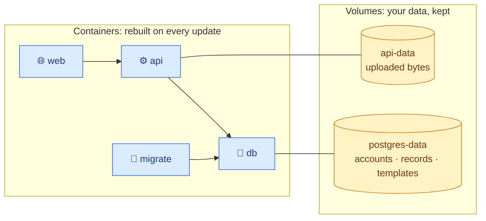
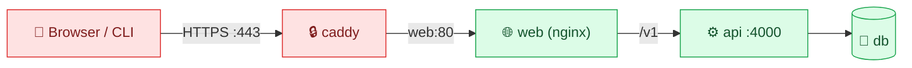
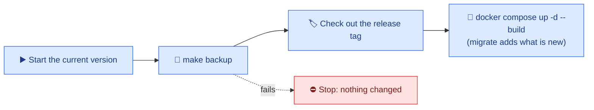
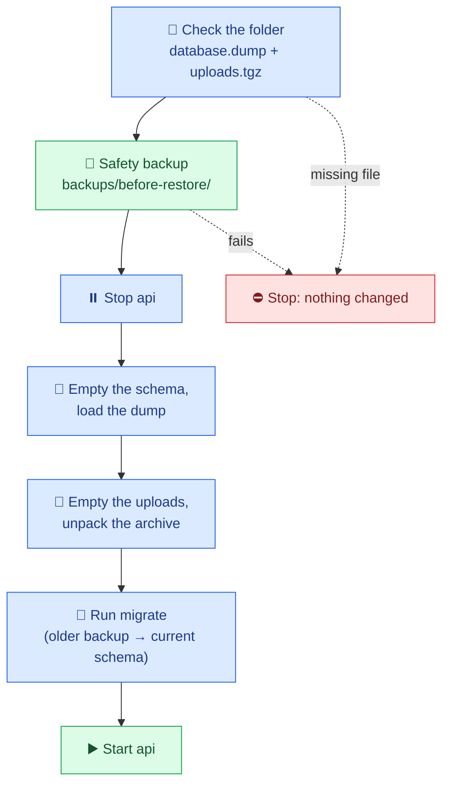

<sub>🏠 [Home](https://github.com/fiwon123/eznit/wiki) › 🛡️ Operate › 🖥️ Deploying on a VPS</sub>

# 🖥️ Deploying on a VPS

**Run the Compose stack on a server you rent, then update it, back it up, move it
and change its password without losing data.**

> [!WARNING]
> **Pre-1.0 and unhardened.** Read the
> [security status](https://github.com/fiwon123/eznit#-security-status) first. A
> VPS is on the internet, so treat this as a test deployment until that section
> says otherwise.

| ✅ Safe any time | ⛔ Deletes data |
| --- | --- |
| `docker compose up -d --build` / `make vps-update` | `docker compose down -v` / `make docker_down_v` |
| `docker compose restart` / `stop` / `down` | `make dev-reset` |
| rebuilding or recreating any container | `docker volume rm …` / `docker volume prune` |
| a VPS reboot | `docker system prune --volumes` |
| `make backup` | the window's **Settings → Reset** (its local folder) |

## ⚡ The short version

```sh
# once
git clone https://github.com/fiwon123/eznit.git /srv/eznit && cd /srv/eznit
make vps-init DOMAIN=eznit.example.com
docker compose up -d --build

# day to day
docker compose up -d          # start
docker compose down           # stop; the data is kept (never add -v)

# update
make vps-update               # back up, then the newest release
```

The rest of this page explains what those commands do.

## 🧠 The one thing to understand: where the data lives

Containers are disposable, and the data is not in them. It lives in two Docker
**named volumes**, which outlive every container:



| Volume | Holds |
| --- | --- |
| 🐘 `postgres-data` | the database: accounts, file records, templates, sessions |
| 📁 `api-data` | the uploaded **bytes** (`/data/uploads` in the `api` container) |

> [!IMPORTANT]
> A file record in the database points at bytes in `api-data`. **Back up and
> restore the two together.** A database without its uploads lists files that are
> gone.

## 🚀 First deploy

### 0️⃣ Prepare the server (once)

```sh
curl -fsSL https://get.docker.com | sudo sh     # Docker + the Compose plugin
sudo usermod -aG docker "$USER"                 # then log out and back in
sudo apt install -y git make
sudo ufw allow 22 && sudo ufw allow 80 && sudo ufw allow 443 && sudo ufw enable
```

Point your domain's DNS **A record** at the server's address. Ports 80 and 443
must be free: stop any web server the image came with (`sudo systemctl disable
--now nginx apache2 caddy`).

### 1️⃣ Get the code and initialise it

```sh
sudo mkdir -p /srv/eznit && sudo chown "$USER" /srv/eznit
git clone https://github.com/fiwon123/eznit.git /srv/eznit
cd /srv/eznit
make vps-init DOMAIN=eznit.example.com
```

`make vps-init` runs `make setup`, then:

| Step | What it does |
| --- | --- |
| 🔑 **Password** | Replaces the example database password with a random one, **only while no database exists yet**. It never prints it: copy `secrets/db_password.txt` into your password manager. |
| 🔒 **Private ports** | Sets `API_BIND=127.0.0.1` and `WEB_BIND=127.0.0.1` in `.env`, so only HTTPS is public. Docker's firewall rules bypass `ufw`, so the bind address is what keeps a port private. |
| 🌐 **HTTPS** | Sets `DOMAIN` and `COMPOSE_PROFILES=https`, which turns on the `caddy` service. Caddy gets and renews the certificate by itself. |
| 🛰️ **Client address** | Sets `TRUST_PROXY=true`, so the login rate limit counts each visitor, not the proxy. |

Running it again is safe. It changes only the domain and what is not set yet.

> [!CAUTION]
> Postgres applies the password **only when it creates the volume**. That is why
> `vps-init` will not replace it once a database exists. Changing it later is a
> separate procedure, [below](#-changing-the-database-password).

### 2️⃣ Start it

```sh
docker compose up -d --build
docker compose ps               # api "healthy", migrate "exited (0)", caddy "running"
```

`-d` keeps it running after you log out, and Docker starts it again after a reboot.
Open `https://eznit.example.com`. The first visit can take a few seconds while
Caddy fetches the certificate.



### 3️⃣ Create your account straight away

> [!IMPORTANT]
> **The first account to sign up becomes the instance's admin.** Sign up yourself
> before you share the address.

In the desktop window, open **Settings → Server**, type
`https://eznit.example.com` and click **Connect**.

<details>
<summary>🛠️ Doing it by hand, or with your own reverse proxy</summary>

`make vps-init` only writes these lines to `.env` and a random password to
`secrets/db_password.txt` (mode `600`):

```sh
API_BIND=127.0.0.1
WEB_BIND=127.0.0.1
TRUST_PROXY=true
DOMAIN=eznit.example.com
COMPOSE_PROFILES=https
```

To keep a reverse proxy you already run on the host, leave out `DOMAIN` and
`COMPOSE_PROFILES` and point it at `127.0.0.1:5173`. With Caddy:

```caddyfile
eznit.example.com {
    reverse_proxy 127.0.0.1:5173
}
```

</details>

## 🔄 Updating without touching the data

```sh
cd /srv/eznit
make vps-update                 # the newest release
make vps-update TAG=v0.39.0     # or a specific one
```



The containers are rebuilt and the volumes are kept. `migrate` applies only the
migrations the database does not have yet. Migrations are **append-only**, so an
update adds to the schema and never rewrites what is there. Expect a few seconds
of downtime.

`vps-update` refuses to run when:

- tracked files have local changes, because the checkout would overwrite them;
- the backup fails;
- the release is **older** than the one running (see the warning below).

> [!NOTE]
> The server runs a **release tag**, not a branch, so `git pull` does not apply
> there: `git status` says "HEAD detached at v0.39.0", which is expected.
> `vps-update` does the fetch and the checkout.

> [!WARNING]
> **Never run a down migration on a deployment you care about.** A down migration
> drops columns and tables. To go back to an older release, restore the backup
> `vps-update` took before the update.

## 💾 Backups

```sh
make backup                     # → backups/<UTC timestamp>/database.dump + uploads.tgz
```

`scripts/backup.sh` does the same without `make`. The stack must be running.

| File | What it is |
| --- | --- |
| 🐘 `database.dump` | a `pg_dump` custom-format dump made **inside** the `db` container, so the password is never read on the host. It is portable across Postgres versions and machines. |
| 📁 `uploads.tgz` | the contents of the uploads volume, with file ownership kept |

> [!CAUTION]
> **A backup on the same disk is not a backup.** Copy it off the machine, on a
> schedule.

```cron
# crontab -e: back up at 03:00, copy it off the machine, keep two weeks locally
0 3 * * * cd /srv/eznit && make backup >> backups/backup.log 2>&1 && rclone copy backups remote:eznit-backups
30 3 * * * find /srv/eznit/backups -mindepth 1 -maxdepth 1 -type d -mtime +14 -exec rm -rf {} +
```

> [!TIP]
> **Restore one once, on purpose, before you need it.** A backup you have never
> restored is a guess.

## ♻️ Restoring, moving, rebuilding

```sh
make restore BACKUP=backups/2026-11-17T030000Z
```



The restore **replaces** the current data, which is why it takes a safety backup
first and stops if that fails. If a later step fails, it still starts `api` again
and says so.

### 🚚 Moving to another server

1. Do a [first deploy](#-first-deploy) there (same release, its own password).
2. `docker compose up -d` once, so the volumes exist.
3. Copy the backup folder over.
4. `make restore BACKUP=…`

### 🧱 Rebuilding the database from zero

Use this for a corrupted volume, or for a new **major** Postgres version, which cannot
read an older version's data folder:

```sh
make backup
docker compose stop api
docker compose rm -sf db
docker volume rm eznit_postgres-data   # <project>_postgres-data; the project is `name:` in docker-compose.yml
docker compose up -d db migrate api web
make restore BACKUP=backups/<the one you just took>
```

## 🔐 Changing the database password

> [!CAUTION]
> Editing `secrets/db_password.txt` alone **breaks the deployment.** Postgres
> stored the old password when it created the volume, so the API and `migrate`
> would start sending a password it does not know.

Change it in the database **first**, then in the file:

```sh
docker compose exec db sh -c 'psql -U "$POSTGRES_USER" -d "$POSTGRES_DB"'
#   ALTER USER root PASSWORD 'the-new-password';
#   \q
# put the same value in secrets/db_password.txt (chmod 600), then:
docker compose up -d --force-recreate api
```

`psql` inside the container connects over the local socket, which needs no
password. That is also the way back in if the file and the database ever disagree.

## 👤 Admin and access

| | |
| --- | --- |
| 👑 **The first account is the admin** | Only an admin may list, change or delete other accounts. No route grants the flag. |
| 🐘 **The database user is a superuser** | `root` is the user the Postgres image creates, and the API connects as it. That is acceptable only while the database answers on loopback and the Compose network. |
| 🔑 **The server itself** | SSH keys only (`PasswordAuthentication no`, `PermitRootLogin no`), a normal user with `sudo`, unattended security updates, and a firewall allowing 22, 80 and 443. |
| 🙈 **Secrets stay out of git** | `.env` and `secrets/db_password.txt` are gitignored and mode `600`. Keep the password in a password manager, not next to the dump. |

Promote another account to admin:

```sh
docker compose exec db sh -c 'psql -U "$POSTGRES_USER" -d "$POSTGRES_DB" -c "UPDATE users SET is_admin = true WHERE email = '\''someone@example.com'\'';"'
```

> [!WARNING]
> Never set `DB_BIND=0.0.0.0` on a VPS. It would put a Postgres superuser on the
> internet.

## 📦 The desktop window's local server

The release bundle's **Local server** runs the API as a process, not as the `api`
container, so its uploads are in the folder `API_UPLOADS` names (`./uploads` by
default), not in a volume. To back it up, dump the database the same way and
copy that folder:

```sh
docker compose exec -T db sh -c 'pg_dump -U "$POSTGRES_USER" -d "$POSTGRES_DB" -Fc' > database.dump
```

`make backup` and `make restore` are for the Compose deployment above.

## 👉 Next

| | |
| --- | --- |
| ⚙️ [Configuration](https://github.com/fiwon123/eznit/wiki/Configuration#-ports-and-bind-addresses) | every bind address and variable |
| 🧯 [Troubleshooting](https://github.com/fiwon123/eznit/wiki/Troubleshooting) | when the database or a port refuses |
| 📦 [Releases](https://github.com/fiwon123/eznit/wiki/Releases) | which tag to deploy, and how to verify it |
