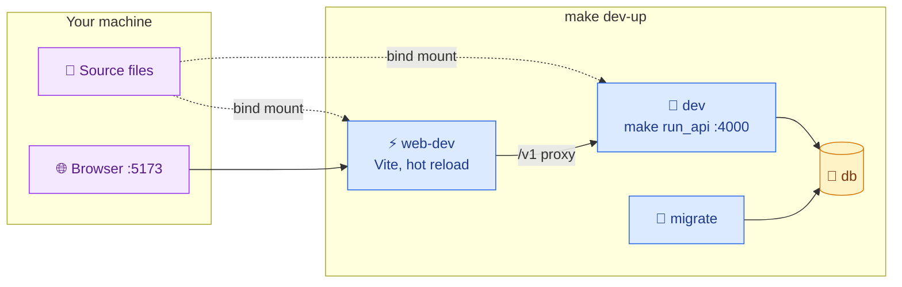

<sub>🏠 [Home](https://github.com/fiwon123/eznit/wiki) › 🛠️ Build › 🔧 Development</sub>

# 🔧 Development

**How to run eznit from source, the sandbox that removes the host-toolchain
requirement, and the gates a change must pass.**

| I want to… | Run |
| --- | --- |
| ✅ verify a change | `make check` (+ `make web_check` for the UI) |
| 🔁 work on the source with hot reload | `make dev-up` → UI :5173, API :4000 |
| 🐳 run the product as users get it | `make up` |
| 🤖 run an AI agent in the sandbox | `make claude` · `make codex` · `make opencode` |
| 🩺 check the whole setup | `make doctor` |

## ✅ The gates

```sh
make check            # gofmt, vet, test, build: the local gate
make web_check        # oxlint, oxfmt, tsc --noEmit, vite build: the web gate
make test_integration # migrations + repository SQL against a real PostgreSQL
make vuln             # reachable-vulnerability scan (needs network)
```

| Gate | Needs | Proves | Does not prove |
| --- | --- | --- | --- |
| `make check` | Go only, with no database or container | formatted, vetted, tested packages pass, everything compiles | SQL, HTTP routes, the browser |
| `make web_check` | Node (the `mise.toml` pin) | lint, format, types, build | that the page looks right |
| `make test_integration` | `TEST_DATABASE_URL` → a database named `*_test` | every migration up and down, every repository's SQL | HTTP end to end |
| `make fyne_race` | cgo + GL headers | the window's suite is race-free | how it looks on a real display |

> [!IMPORTANT]
> **A green `make check` means "the packages with tests passed", not coverage.**
> `go test` prints `[no test files]` and still exits 0, so `make check` lists
> those packages. Name the packages when you report a result.

> [!NOTE]
> CI (Go), CI (Web) and CI (Image) run on **release** pull requests (`dev` →
> `main`) and on manual dispatch. CI (GUI) also runs on pull requests into `dev`
> that touch Go code. Everything else is gated locally, so run the gates before you
> push.

## 🧪 The dev sandbox

The sandbox is a container with Go **1.27.4** (the version in `go.mod`, the same
one CI uses), with the workspace bind-mounted, so the files you edit are the same
files. The frontend runs the same way in `web-dev`, using the Node from `mise.toml`.



```sh
make dev-up       # the loop: UI :5173 (hot reload) + API :4000
make dev-shell    # a shell inside the sandbox
make dev-restart  # stop and start again (no rebuild)
make dev-build    # rebuild the images after a Dockerfile edit
make dev-down     # stop it (keeps the volumes)
```

| You edit | What happens |
| --- | --- |
| a `.tsx` / `.ts` file | ⚡ Vite reloads the browser |
| a `.go` file | 🔁 restart the API: there is no Go file watcher |
| a `Dockerfile`, `web/Dockerfile.dev` or a script one of them copies | 🏗️ `make dev-build`; `dev-up` refuses a stale image and names it |

> [!TIP]
> After a Go pin bump, `dev-up` checks the image's toolchain against `go.mod`
> **before** starting (`scripts/check-dev-toolchain.sh`) and names `make
> dev-build`, instead of letting the API die inside the log stream.

<details>
<summary><b>Without Make, and on Windows</b></summary>

```sh
mkdir -p .dev && touch .dev/sandbox-start   # makes the sandbox run the API
docker compose up dev web-dev db migrate     # the whole loop
python scripts/dev-up.py dev-up              # native Windows: the same
```

| Platform | Dev flow |
| --- | --- |
| Linux, macOS, WSL2 | `make dev-up` |
| Windows (native) | `python scripts/dev-up.py dev-up` |

`Ctrl-C` leaves the loop running, and `make dev-down` stops it. The marker
`.dev/sandbox-start` (gitignored) tells the entrypoint to start the API rather than
sleep. Inside the sandbox, Compose sets `DB_HOST=db` and `DB_PORT=5432`, and the
host's `.env` is not imported.

</details>

### 🤖 AI agents in the sandbox

`make claude`, `make codex` and `make opencode` (and their `-auto` variants) run
that agent inside the sandbox on any host OS, and start the dev loop beside it
(`AGENT_LOOP=0` starts the sandbox alone).

| | |
| --- | --- |
| 🔑 Logins | asked for once, kept in a Docker volume, so restarts and rebuilds keep you signed in |
| ⬆️ Upgrades | `make claude-upgrade` (or `agents-upgrade`) moves to the latest release |
| 🩺 Health | `make doctor` checks Docker, the image, the GitHub token and every login |
| 🔒 Boundary | no Docker socket inside: the agent cannot manage containers, on purpose |

## 🖥️ The desktop app

The window is [Fyne](https://fyne.io), and Fyne needs cgo, which is why it is not in
`make check`. Every Fyne file carries `//go:build fyne`, so a machine without GL can
still pass the gate.

| Target | What it does |
| --- | --- |
| `make build_gui` | builds `build/gui/eznit-gui` for the host (cgo + GL/X11 headers) |
| `make gui_check` | `go vet` and `go test` with `-tags fyne` |
| `make fyne_race` | the window's suite under `-race` (about 2 minutes) |

Debian/Ubuntu headers: `libgl1-mesa-dev xorg-dev libwayland-dev libxkbcommon-dev
wayland-protocols`. macOS: the Xcode command line tools.

> [!NOTE]
> **Why `fyne_race` exists:** Fyne's test driver runs `fyne.Do` *inline on the
> calling goroutine*, so a worker's widget work overlaps the test that started it.
> The window counts its background work and the tests wait for it
> (`internal/fyneui/work.go`). The `-race` run took that from 319 reports to zero,
> and CI (GUI) runs the same command.

The window is an HTTP client (`internal/fyneui`) plus a supervisor for a local
server (`internal/serverctl`). The supervisor is **plain Go**, so `make check`
covers what a start checks, what a stop means and what a save preserves. File and
folder choices go through a `picker` seam: the system dialog (zenity) in the app,
and Fyne's dialog in the tests.

**CI (GUI)** vets, tests and builds the window, then **opens it** on a virtual X
server (`xvfb` with software GL) and checks it is still alive ten seconds later.
That proves startup, not looks.

## 🧱 Migrations

`db/migrations/` is **append-only history**: one numbered `.up.sql` / `.down.sql`
pair per change, applied by `golang-migrate`.

```sh
make migrate_up
make migrate_down      # one step
make migrate_down_all
```

> [!CAUTION]
> **Never edit a migration that has run somewhere.** Add the next pair instead.

Constraints belong in the schema where they can be expressed (`UNIQUE`,
`FOREIGN KEY`), not only in Go, because a constraint in Postgres cannot be forgotten
by a new code path.

## 🧭 Where a change belongs

```text
cmd/               the entrypoints: cli, gui
internal/server/   eznit serve: logger, database, router, graceful shutdown
internal/domain/   one package per resource (users, sessions, files, templates, commands)
                   handler → service → repository, plus dto.go
internal/platform/ middleware (session guard), sql, webui (SPA), openapi
internal/cli/      the CLI commands
internal/fyneui/   the desktop window
internal/serverctl/ the window's local-server supervisor
pkg/               logger, errors, http/json helpers, path helpers, types
db/migrations/     golang-migrate SQL
web/               React + TypeScript UI, embedded into the binaries
```

| Layer | Does | Never |
| --- | --- | --- |
| **handler** | decodes the request, writes the response | queries the database |
| **service** | holds the rules | speaks HTTP |
| **repository** | is the only place that speaks SQL | returns an HTTP status |

[ARCHITECTURE.md](https://github.com/fiwon123/eznit/blob/dev/ARCHITECTURE.md) has
the full map.

## 🎯 Make targets

| Target | What it does |
| --- | --- |
| `make setup` | create `.env` and the database secret from their examples |
| `make build` | the local binaries into `./build` (and the UI they embed) |
| `make release` | one-folder archives for every platform into `./build/dist` |
| `make run_api` / `make run_cli` | run the API / the CLI |
| `make up` | the product: UI :5173, API :4000, db, migrations |
| `make backup` / `make restore BACKUP=…` | back up / restore a Compose deployment |
| `make web_install` / `web_build` / `web_dev` / `web_check` | the web UI |
| `make wiki_push` | publish `docs/wiki/` to this wiki |
| `make screenshots` | capture the README screenshots (needs the app running) |

## 👉 Next

| | |
| --- | --- |
| 📦 [Releases](https://github.com/fiwon123/eznit/wiki/Releases) | how a release is cut and verified |
| 🤝 [Contributing](https://github.com/fiwon123/eznit/blob/dev/CONTRIBUTING.md) | issues, branches, pull requests |
| 🧯 [Troubleshooting](https://github.com/fiwon123/eznit/wiki/Troubleshooting#-stack-and-sandbox) | sandbox and port problems |
