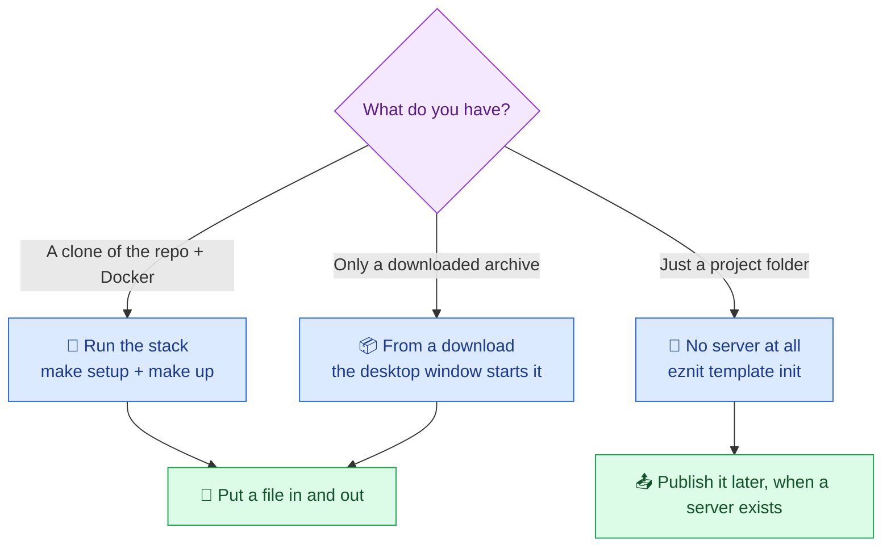

<sub>🏠 [Home](https://github.com/fiwon123/eznit/wiki) › 🚀 Getting Started</sub>

# 🚀 Getting Started

**From nothing to a file in and out, in about five minutes.** Pick the path that
matches what you have.



## ✅ What you need

| Path | Needs |
| --- | --- |
| 🐳 **Run the stack** | [Docker](https://docs.docker.com/get-docker/) with Compose. Nothing else. |
| 📦 **From a download** | Docker or Podman for the database, or a PostgreSQL you already run |
| 🧩 **No server** | Only the `eznit` binary |
| 🛠️ **Build from source** | Go (the version in `go.mod`), plus Node for the web UI |

## 🐳 Run the stack

`make setup` creates two local files from the committed examples: the
configuration (`.env`) and the database secret (`secrets/db_password.txt`). Both
are gitignored and mode `600`.

```sh
make setup
make up             # or: docker compose up
```

`make up` builds the two images (`web/Dockerfile` for nginx, `Dockerfile.api` for
the API) and waits for PostgreSQL to be healthy. It runs the `migrate` service
once, then starts:

| Role | Service | Open |
| --- | --- | --- |
| 🌐 Web UI (nginx) | `web` | **http://localhost:5173** |
| ⚙️ API | `api` | **http://localhost:4000** |
| 📚 API reference (Swagger UI) | either | `/docs` |
| 🐘 PostgreSQL | `db` | `127.0.0.1:5432` (this machine only) |

<details>
<summary><b>Without <code>make</code></b></summary>

```sh
cp .env.example .env
cp secrets/db_password.txt.example secrets/db_password.txt   # then put a real password in it
chmod 600 .env secrets/db_password.txt
docker compose up
```

</details>

> [!NOTE]
> Your data lives in two Docker volumes: `postgres-data` (the database) and
> `api-data` (the uploaded bytes). Both survive `docker compose down`, but
> **`down -v` deletes them.** See
> [Deploying on a VPS](https://github.com/fiwon123/eznit/wiki/Deploying-on-a-VPS#-the-one-thing-to-understand-where-the-data-lives).

## 📄 Put a file in and out

The CLI is the `eznit` binary (alias `ez`). Build it with `make build_cli` or take
it from a [release archive](https://github.com/fiwon123/eznit/releases/latest).

```sh
eznit signup     # Email / Password / Confirm. The first account is the admin.
eznit login      # keeps a session token in ~/.eznit/config.json (mode 0600)
eznit upload     # file path: ./notes.txt
eznit list       # the files you own, with their ids
eznit download   # id: <id>   destination folder: ./out
```

The core commands **ask** for what they need instead of taking flags. Everything
that touches your own files needs the session from `login`.

## 🧩 Use it on a project (no server)

This needs no server, no login and no Docker. It writes a starter into a folder:

```sh
eznit template init --kind opencode --target ./demo
```

| `--kind` | Writes |
| --- | --- |
| `opencode` · `copilot` · `cursor` · `windsurf` | `AGENTS.md` plus the files that tool reads |
| `codex` · `generic` | `AGENTS.md` |
| `bash` · `zsh` · `fish` · `powershell` | one commented shell snippet |

It asks for the project name, description and language and fills them in.
[Templates and skills](https://github.com/fiwon123/eznit/wiki/Templates-and-Skills)
shows what each kind writes.

When a server exists, share the folder and pull it elsewhere:

```sh
eznit template publish ./demo --public    # asks name, kind, description, defaults
eznit template list                       # note the id
eznit template apply <id> --target ../another-project
```

> [!TIP]
> `apply` asks for the variables on **the machine that writes the files**. A value
> you type never travels to the server.

To take a template to a machine with no server, export it to one file:

```sh
eznit template export <id> -o setup.eznit
eznit template apply --from-file setup.eznit --target ../another-project
```

## 📦 From a download (no source)

A release archive is the whole product: `eznit` (client **and** server), `ez`,
the `eznit-gui` window, the migrations and a `docker-compose.yml` for the
database. It is **not** a source checkout, so there is no image to build.

### 🖥️ With the window (recommended)

Run `eznit-gui` **from inside the extracted folder**. Settings → Local server
looks for `eznit` beside the window.

| # | Where | Do |
| :---: | --- | --- |
| 1️⃣ | **Settings → Local server → Configuration** | **Create .env from the example**, set the database password, then **Save configuration**. |
| 2️⃣ | **Settings → Local server** | **Start**. It brings up the database through the folder's Compose file, applies the migrations, then starts the API. **Output** shows the log, and the dot turns green. |
| 3️⃣ | **Settings → Server** | **Use this machine** is checked: **Test**, then **Connect**. |
| 4️⃣ | **Log in** (top right) | Create the first account. It is the instance's **admin**. **Workspace** appears once you are in. |

> [!IMPORTANT]
> Step 1 is the one step Start cannot do for you. Postgres stores its password
> **when it creates the volume**, so set it before the first Start.

> [!CAUTION]
> **Settings → Reset** erases every account, file and template of the local
> server, after a confirmation. It keeps `.env` and the password. To reset a
> different folder, choose it in **Local server** first.

### ⌨️ With a terminal

```sh
cp secrets/db_password.txt.example secrets/db_password.txt   # then edit it
cp .env.example .env                                         # then edit it
docker compose up -d db migrate

DB_HOST=localhost DB_PORT=5432 DB_PASSWORD_FILE=secrets/db_password.txt ./eznit serve
# → the embedded web UI on http://localhost:4000
```

`RUNNING.md` in the archive gives the same steps and says what they do not prove.
Plain `docker compose up` is the source-checkout path. In an archive it would try
to build an image the archive does not contain.

### 🌍 Only a client

The window can also talk to a server somewhere else, with no archive set up: type
the address in **Settings → Server**, then **Test** and **Connect**.

## 👉 Next

| | |
| --- | --- |
| 🧩 [Templates and skills](https://github.com/fiwon123/eznit/wiki/Templates-and-Skills) | what to put in a template, variables, offline bundles |
| 💻 [CLI Reference](https://github.com/fiwon123/eznit/wiki/CLI-Reference) | every command and flag |
| ⚙️ [Configuration](https://github.com/fiwon123/eznit/wiki/Configuration) | variables, secrets and ports |
| 🧯 [Troubleshooting](https://github.com/fiwon123/eznit/wiki/Troubleshooting) | a busy port, a missing secret, a database that will not start |
