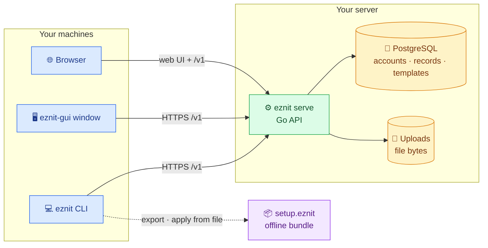

# 🏠 eznit

### Your project's setup, in one place you host.

Templates, scripts and files you pull onto any machine. It is self-hosted, with no
subscription and no third party.

**[🚀 Get started](https://github.com/fiwon123/eznit/wiki/Getting-Started)** ·
**[📦 Download](https://github.com/fiwon123/eznit/releases/latest)** ·
**[💻 CLI](https://github.com/fiwon123/eznit/wiki/CLI-Reference)** ·
**[🖥️ Deploy](https://github.com/fiwon123/eznit/wiki/Deploying-on-a-VPS)**

---

## ✨ What it does

| | |
| --- | --- |
| 🗂️ **One place for a project's files** | Agent instructions, editor rules, skills, scripts, and any text or binary file. |
| 📤 **Publish once, apply anywhere** | A folder becomes a template, and the next machine gets it with `eznit template apply <id>`. |
| 🤖 **With or without AI** | Starters for opencode, Codex, Copilot, Cursor and Windsurf. Plain shell and editor configuration travels too. |
| ✈️ **Works offline** | `template init` needs no server, and an exported `.eznit` bundle applies with no account. |
| 🔐 **Yours** | The bytes stay on your disk and in your PostgreSQL, with no third-party account. |

> [!WARNING]
> **Pre-1.0 and unhardened.** Read the
> [security status](https://github.com/fiwon123/eznit#-security-status) before you
> expose an instance beyond `localhost`. To run it on a server anyway,
> [Deploying on a VPS](https://github.com/fiwon123/eznit/wiki/Deploying-on-a-VPS)
> shows the safe defaults.

## 🧭 Choose your path

| I want to… | Go to | Time |
| --- | --- | --- |
| 🧪 try it on my machine | [Getting Started](https://github.com/fiwon123/eznit/wiki/Getting-Started) | ⏱️ 5 min |
| 🧩 publish and apply a template | [Templates and skills](https://github.com/fiwon123/eznit/wiki/Templates-and-Skills) | ⏱️ 10 min |
| 💻 look up a command or flag | [CLI Reference](https://github.com/fiwon123/eznit/wiki/CLI-Reference) | 📖 reference |
| ⚙️ set a variable, secret or port | [Configuration](https://github.com/fiwon123/eznit/wiki/Configuration) | 📖 reference |
| 🖥️ run it on a VPS **without losing data** | [Deploying on a VPS](https://github.com/fiwon123/eznit/wiki/Deploying-on-a-VPS) | ⏱️ 30 min |
| 🐧 know what runs on my OS or shell | [Platforms and shells](https://github.com/fiwon123/eznit/wiki/Platforms-and-Shells) | 📖 reference |
| 🧯 fix an error | [Troubleshooting](https://github.com/fiwon123/eznit/wiki/Troubleshooting) | 🔎 lookup |
| 🛠️ change the code or cut a release | [Development](https://github.com/fiwon123/eznit/wiki/Development) · [Releases](https://github.com/fiwon123/eznit/wiki/Releases) | 📖 reference |
| 🔭 see what is planned | [Direction](https://github.com/fiwon123/eznit/wiki/Direction) | 📖 reference |

## 🚀 Six steps from zero to a shared setup

| # | Step | Command | What happens |
| :---: | --- | --- | --- |
| 1️⃣ | **Run it** | `make setup && make up` | Docker starts the API, the web UI, PostgreSQL and the migrations |
| 2️⃣ | **Write a starter** | `eznit template init --kind opencode --target ./demo` | Files appear in `./demo`, with no server or account needed |
| 3️⃣ | **Create an account** | `eznit signup` | The first account on an instance is its **admin** |
| 4️⃣ | **Publish it** | `eznit template publish ./demo --public` | The folder joins the shared catalogue |
| 5️⃣ | **Apply it elsewhere** | `eznit template apply <id> --target ../other` | The files are written, and the variables are asked on that machine |
| 6️⃣ | **Take it offline** | `eznit template export <id> -o setup.eznit` | One file; `apply --from-file` needs no server |

> [!TIP]
> No Go, no Node, no Docker? Download the archive for your platform from
> [Releases](https://github.com/fiwon123/eznit/releases/latest). It carries the CLI,
> the server and the desktop window. Then follow
> [Getting Started → From a download](https://github.com/fiwon123/eznit/wiki/Getting-Started#-from-a-download-no-source).

## 🧱 How it fits together

One binary, `eznit`, is both the client and the server (`eznit serve`). The window,
`eznit-gui`, is a client that can also start a server on this machine. For the
request path, the data model and where a change belongs, see
[ARCHITECTURE.md](https://github.com/fiwon123/eznit/blob/dev/ARCHITECTURE.md).

## 🔗 Also useful

| | |
| --- | --- |
| 📘 [README](https://github.com/fiwon123/eznit#readme) | the short project overview |
| 🏗️ [ARCHITECTURE](https://github.com/fiwon123/eznit/blob/dev/ARCHITECTURE.md) | request path, data model, where the bytes live |
| 🗺️ [Roadmap board](https://github.com/users/fiwon123/projects/12) | planned work (the issues are the source of truth) |
| 📦 [Releases](https://github.com/fiwon123/eznit/releases) | downloadable archives and checksums |
| 🤝 [Contributing](https://github.com/fiwon123/eznit/blob/dev/CONTRIBUTING.md) | how to propose a change |
