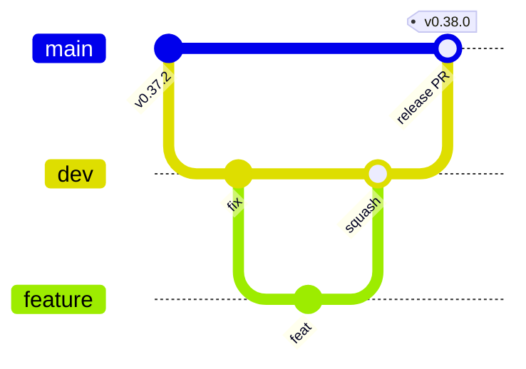
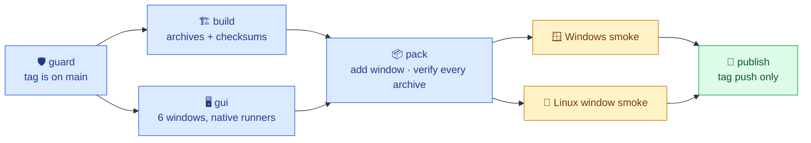

<sub>🏠 [Home](https://github.com/fiwon123/eznit/wiki) › 🛠️ Build › 📦 Releases</sub>

# 📦 Releases

**How a release is cut, what the pipeline checks before anything is published,
and what each archive holds.** Downloads are on the
[releases page](https://github.com/fiwon123/eznit/releases/latest).

| Asset | Contents |
| --- | --- |
| 🐧 `eznit_<version>_linux_<arch>.tar.gz` | everything below, for Linux amd64 / arm64 |
| 🪟 `eznit_<version>_windows_<arch>.zip` | everything below, for Windows amd64 / arm64 |
| 🍎 `eznit_<version>_darwin_<arch>.tar.gz` | everything below, for macOS amd64 / arm64 |
| 🔏 `checksums.txt` | SHA-256 of every archive |

**Each archive** extracts into one folder named after it:

| | |
| --- | --- |
| ⚙️ `eznit` + `ez` | the CLI **and** the API (`eznit serve`) |
| 🖥️ `eznit-gui` | the desktop window |
| 🐳 `docker-compose.yml`, `db/migrations/`, `scripts/run_migrate.sh` | the database and its migrations |
| 📝 `.env.example`, `secrets/db_password.txt.example`, `RUNNING.md` | the configuration to copy, and how to run it |
| 🛣️ `add_to_path.sh` / `add_to_path.ps1` | puts the binaries on your PATH |
| ⚖️ `README.md`, `LICENSE`, `LICENSE-FYNE`, `LICENSE-APACHE`, `LICENSE-ZENITY`, `NOTICE` | the licences that travel with the binaries |

## ✅ Verify a download

```sh
sha256sum -c checksums.txt          # macOS: shasum -a 256 -c checksums.txt
```

> [!TIP]
> `eznit update` and the window's **About → Install** do this check for you,
> **before** anything is replaced.

## 🏁 How a release is cut



1. Merge the milestone's work into `dev` through pull requests (squash).
2. Open a release pull request `dev` → `main` and merge it with a **merge commit**,
   not a squash, so `dev` stays an ancestor of `main`.
3. Tag the **merge commit on `main`** and push the tag:

```sh
git fetch origin main
git tag -a v<version> "$(git rev-parse origin/main)" -m "Release v<version>"
git push origin v<version>
```

> [!CAUTION]
> Never pass `--delete-branch` on a release merge: the release PR's head **is**
> `dev`, and deleting it breaks every future pull request.

## 🚦 The pipeline

`.github/workflows/release.yml` runs on the tag push:



| Job | Checks |
| --- | --- |
| 🛡️ **guard** | the tag points at a commit on `main`; version and commit are resolved once |
| 🏗️ **build** | `make release VERSION=<tag>` (the same target a developer runs), with read-only permissions |
| 🖥️ **gui** | `eznit-gui` for all six platforms: Windows with mingw / llvm-mingw, macOS natively, and Linux inside a **Debian 12** container so the download needs only glibc **2.34** |
| 📦 **pack** | adds the window and its licences to each archive, then verifies names, PE, Mach-O and provenance, and rebuilds the checksums |
| 🪟 **Windows smoke** | unpacks the Windows archive and runs `eznit -v`, `ez -v`, `eznit.exe serve --help`, `eznit-gui.exe --help` |
| 🐧 **Linux window smoke** | starts the published window on a virtual display |
| 🚀 **publish** | re-verifies the checksums, writes the notes from the PRs merged into `dev`, and creates the GitHub Release |

> [!NOTE]
> **Manual dispatch is a dry run.** It runs everything except **publish** and keeps
> the archives on the run. A green dry run does not prove the publish step; only a
> real tag does.

## 🔍 What is verified, and what is not

Every archive is read back after it is written: exactly one top-level folder named
like the archive, no `..` member, the PE of every Windows binary, the **Mach-O**
type and CPU of every macOS binary, and the build's revision with
`vcs.modified=false`. Every Windows binary carries an icon, a per-monitor DPI
manifest and a version block.

| Platform | Started by a gate? |
| --- | --- |
| 🪟 Windows amd64 | ✅ the CLI and the window |
| 🐧 Linux amd64 | ✅ the window, on a virtual display |
| 🐧 Linux arm64 · 🪟 Windows arm64 | ⚪ built natively, never started on ARM |
| 🍎 macOS amd64 · arm64 | ⚪ window built natively, CLI cross-compiled; Mach-O checked, never started |

## 🏃 Running a download

The archive is the whole product, not a source checkout: there is no `go.mod`, no
`web/` and no image to build. The database and the migrations come from published
images plus the SQL in `db/migrations/`. Start them, then run the prebuilt server.
The easiest way is the window: **Settings → Local server → Start**. See
[Getting Started → From a download](https://github.com/fiwon123/eznit/wiki/Getting-Started#-from-a-download-no-source).

## 👉 Next

| | |
| --- | --- |
| 🚀 [Getting Started](https://github.com/fiwon123/eznit/wiki/Getting-Started#-from-a-download-no-source) | run what you downloaded |
| 🐧 [Platforms and shells](https://github.com/fiwon123/eznit/wiki/Platforms-and-Shells) | what runs where |
| 🔧 [Development](https://github.com/fiwon123/eznit/wiki/Development) | the gates before a release |
