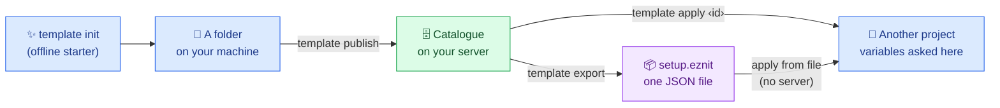

<sub>🏠 [Home](https://github.com/fiwon123/eznit/wiki) › 🧩 Templates and skills</sub>

# 🧩 Templates and skills

**A template is a folder you keep once and write onto other machines.** It can
hold agent instructions, editor rules, skills, scripts or project scaffolding.
Publishing it makes one copy the source of truth, and applying it is the setup
step.



| Without a server | With a server |
| --- | --- |
| ✨ `template init` writes a built-in starter | 📤 `template publish` adds a folder to the catalogue |
| 📦 `template apply --from-file` writes an exported bundle | 📥 `template apply <id>` writes it anywhere |
| | 🖥️ the window's **Explore** and **Workspace** browse, preview, apply and publish |

## 🗂️ What goes in a template

Any file, in any folder shape. These are the ones people actually keep:

| What | Example paths |
| --- | --- |
| 🤖 Agent instructions | `AGENTS.md`, `CLAUDE.md` |
| 🧠 opencode agents and skills | `.opencode/agents/build.md`, `.opencode/skills/deploy/SKILL.md` |
| ✏️ Editor rules | `.cursor/rules/project.mdc`, `.windsurf/rules/project.md`, `.github/copilot-instructions.md` |
| 🐚 Shell configuration | `shell/zshrc.sh`, `shell/profile.ps1` |
| 🧰 Project files | `Makefile`, `.editorconfig`, `.gitignore`, `docker-compose.yml` |
| 🖼️ Binary helpers | an image, a compiled tool, a font: anything non-text |

```text
my-setup/
├── AGENTS.md
├── .opencode/
│   ├── agents/build.md
│   └── skills/deploy/SKILL.md
├── .cursor/rules/project.mdc
└── shell/zshrc.sh
```

> [!NOTE]
> Files are written **relative to the target folder**, so `..` and absolute paths
> are refused. A file marked executable is written with mode `0755`.

### ✨ The built-in starters

`eznit template init --kind <kind> --target <dir>` writes one offline, with no server
and no account:

| Kind | Writes |
| --- | --- |
| `opencode` | `AGENTS.md`, `.opencode/agents/build.md`, `plan.md`, `reviewer.md` |
| `copilot` | `AGENTS.md`, `.github/copilot-instructions.md` |
| `cursor` | `AGENTS.md`, `.cursor/rules/project.mdc` |
| `windsurf` | `AGENTS.md`, `.windsurf/rules/project.md` |
| `codex`, `generic` | `AGENTS.md` |
| `bash` · `zsh` · `fish` · `powershell` | `shell/bashrc.sh` · `shell/zshrc.sh` · `shell/config.fish` · `shell/profile.ps1` |

## 📤 Publish, list, show, apply

```sh
eznit template publish ./my-setup      # asks name, kind, description, public?
eznit template publish ./my-setup --public --commands <id>=shell/zshrc.sh
eznit template list                    # the public catalogue + your own
eznit template list --mine --kind opencode
eznit template show <id>               # its files and its variables
eznit template apply <id> --target ../other-project [--force]
```

- `publish` reads every file in the folder. It skips symlinks, `.git`,
  `node_modules` and the like, and names any file over the limits.
- `apply` **checks every file before writing any**. An existing file stops it
  unless you pass `--force`.
- A **public** template applies without a session. Your private ones need
  `eznit login`.

### 🖥️ From the window

| Where | What you can do |
| --- | --- |
| **Explore** | Browse public templates and shared files with a Templates / Files / All filter. Open one to see its files as a tree with a preview, then **Apply…** or **Download**. |
| **Workspace** *(signed in)* | Your own files and templates. **Upload file…**, **Publish template…**, and switch an item's **Visibility** after a confirmation. |

**Publish template…** opens the folder in your system's file dialog and shows a
form: name (the folder's by default), kind, description, visibility (Private by
default), and a default for each `{{PLACEHOLDER}}`. It walks the folder the same
way the CLI does.

## 🤔 A shared file is not a template

| | 📄 Sharing a file | 🧩 Publishing a template |
| --- | --- | --- |
| **Covers** | one file | a whole folder |
| **How** | **Visibility → Public** on the file's page, or `eznit share` | **Publish template…**, **New template** on the web, or `eznit template publish` |
| **Result** | anyone on the instance can download that file | the folder joins the catalogue with a name, a kind and its `{{variables}}` |
| **Listed in** | Explore, as a *file* (no account needed) | the template catalogue |

The kind filter lists **template kinds** (`opencode` … `powershell`). **All kinds**
means "no filter". It is not a list of your files.

## 🔤 Variables

Write a placeholder in any text file and it becomes a variable:

```markdown
# {{PROJECT_NAME}}

{{PROJECT_DESCRIPTION}}
```

| When | What happens |
| --- | --- |
| **publish** | each distinct placeholder is asked once for a **default**. An empty default makes it **required**. |
| **apply** | the values are asked on the writing machine and substituted into text files. Binary files are copied byte for byte. |
| **undeclared** | a placeholder the template does not declare is left alone and **reported**. |

Names are upper case (`PROJECT_NAME`), up to 50 per template.

> [!TIP]
> Variable values are **never stored on the server**. They exist only where the
> files are written.

## ⚙️ Commands pulled in by id

A command is a script kept once in your library and referenced by templates.
Updating it updates every template that pulls it in.

```sh
eznit command add scripts/fmt.sh --name fmt      # keep it once
eznit command list
eznit template publish . --commands <command-id>=bin/fmt
eznit command remove fmt                          # refused while a template uses it
```

A name is unique per user. `command remove` answers `409` while a template still
references the command, so a published template never quietly loses a script.

🔁 The library also round-trips through a [crower](https://github.com/fiwon123/crower)
TOML pack: `eznit command export --crower pack.toml` and
`eznit command import --crower pack.toml`. The mapping is in the
[CLI Reference](https://github.com/fiwon123/eznit/wiki/CLI-Reference#-commands-library).

## 📦 Take it with you (no server)

```sh
eznit template export <id> -o setup.eznit     # a private template needs a session
eznit template apply --from-file setup.eznit --target ../another-project
```

- The bundle is JSON (`format: 1`) holding the files, text and binary, and the
  variables with their prompts and defaults.
- A command the template pulls in is written at its target path, so the bundle is
  a **snapshot to apply**, not a publish request.
- The same path rules and limits are checked when it is read, so a bundle cannot
  be used to get around them.
- `export` refuses to overwrite an existing file without `--force`.

## 🧮 Limits

Checked by the CLI before the upload **and** by the server on the request:

| Thing | Limit |
| --- | ---: |
| Files per template | **200** |
| Text file | **256 KiB** |
| Text across the template | **4 MiB** |
| Binary file | **10 MiB** |
| Binary across the template | **32 MiB** |
| Variables | **50** |
| Commands per template | **50** |

## 🔒 What never travels

| | Stays |
| --- | --- |
| 🔤 Variable values | on the machine that writes the files |
| 🔑 Your git-host token | in `~/.eznit/config.json` on your machine |

> [!NOTE]
> **Not available yet:** device-to-device transfer over cthrone. See
> [Direction](https://github.com/fiwon123/eznit/wiki/Direction). Until then, an
> offline bundle is how to share without a shared instance.

## 👉 Next

| | |
| --- | --- |
| 💻 [CLI Reference](https://github.com/fiwon123/eznit/wiki/CLI-Reference#-templates) | every template flag |
| 🐚 [Platforms and shells](https://github.com/fiwon123/eznit/wiki/Platforms-and-Shells) | what survives a Linux ↔ Windows round trip |
| 🧯 [Troubleshooting](https://github.com/fiwon123/eznit/wiki/Troubleshooting#-templates) | apply stops, publish skips a file, 401 |
